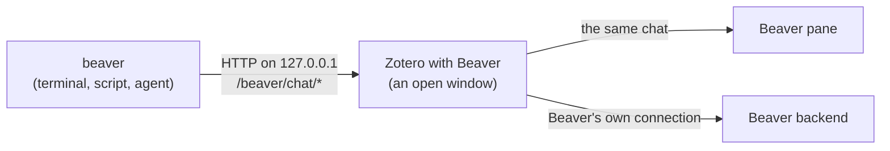

# beaver-cli

`beaver` is a terminal client for [Beaver](https://github.com/jlegewie/beaver-zotero), the AI
research assistant that runs as a Zotero plugin: an interactive chat, and a one-shot mode for
scripts and AI agents.

This is an unofficial project by a Beaver user. It is not affiliated with or endorsed by the Beaver
developers.

```
$ beaver
› How do Green 2022 and Wong 2020 differ on algorithmic fairness?

  · Item search: Green
  · Item search: Wong
  · Extracting: Green's fairness argument

  Green (2022) argues that fairness must be judged substantively: look beyond an algorithm's
  isolated metrics to the social inequalities it operates within and whether it helps reduce
  them. (Green 2022) Wong (2020), by contrast, emphasizes that choosing fairness measures is a
  political choice among competing values, so fairness requires public deliberation and
  accountable, revisable decisions that include affected people. (Wong 2020)

  Sources
    [1] Green, Ben (2022). Escaping the Impossibility of Fairness: From Formal to Substantive
        Algorithmic Fairness. Philosophy & Technology, 35(4), 90.
        cited: pp. 16, 21
        zotero://select/library/items/3J8EXRWD
    [2] Wong, Pak-Hang (2020). Democratizing Algorithmic Fairness. Philosophy & Technology, 33,
        225-244.
        cited: pp. 4, 7, 10
        zotero://select/library/items/RFJ7HVQ2
```

The same kind of question from a script or an AI agent gives one JSON object (shown wrapped and
trimmed; the command prints it on one line):

```
$ beaver -p --json "What is one paper in my library about algorithmic fairness? Cite it."
{ "schema_version": 1, "status": "ok",
  "thread_id": "a1111111-1111-4111-8111-111111111111",
  "answer": "Holm’s (2023) “The Fairness in Algorithmic Fairness” examines what fairness means in
             algorithmic decision-making and how competing fairness criteria can be understood. (Holm 2023)",
  "sources": [{ "n": 1, "display_name": "Holm 2023",
                "reference": "Holm, Sune (2023). The Fairness in Algorithmic Fairness. Res Publica, 29(2), 265-281.",
                "item_key": "PVX9VYC4", "library_ref": "u",
                "zotero_uri": "zotero://select/library/items/PVX9VYC4" }],
  "applied_actions": [], "declined_actions": [], "warnings": [], "error": null, ... }
```

## Why

Some research work happens in a terminal, often on another machine over ssh, where the Zotero
window is out of reach. `beaver` brings Beaver's chat there, and it is the same chat: a
conversation started in the terminal appears in the Beaver pane in Zotero, and one started in the
pane can be continued in the terminal. AI coding agents (Claude Code and similar) can ask Beaver
about the user's own library with one command and read a structured answer with citations.

## How it works

`beaver` drives the chat of a Zotero window that is open on the same computer. It talks to a small
family of local routes, `/beaver/chat/*`, on Zotero's built-in HTTP server (127.0.0.1). Beaver runs
its agent as it does for a message typed in the pane; the command sends the message, follows the
run, answers what the run asks for, and reads the finished answer with its citations.



The routes are not part of Beaver. They live in a fork branch,
[josk0/beaver-zotero `cli-chat-routes`](https://github.com/josk0/beaver-zotero/tree/cli-chat-routes),
and are documented in its
[`docs/chat-routes.md`](https://github.com/josk0/beaver-zotero/blob/cli-chat-routes/docs/chat-routes.md).
The plugin-side change is:

- one setting, **Terminal and script access** in Beaver's advanced settings, off by default; the
  routes exist only while it is on;
- nine routes (`info`, `threads`, `open`, `send`, `status`, `approve`, `apply`, `stop`, `thread`)
  that wrap functions Beaver already has;
- two small opt-in options in the chat core: `detached` on send (send only the given items, leave
  the window's composer and context alone, report a refusal instead of showing it), and
  `canCommit` on opening a new chat (refuse instead of asking to stop a response).

## Status

A working prototype. It needs a Beaver build from the fork branch above (based on Beaver
v0.27.0-beta.3); released Beaver builds have no such routes.

Checked live on macOS, against a staging build of the fork: the live test suite (a script-mode
answer with citations, a follow-up in the same chat, error paths, a timeout, an interactive
session), a note edit that was declined in script mode and then applied with `beaver apply`, and
the interactive prompt in a pseudo-terminal (line editing, history, Ctrl-C, Ctrl-D).

Not checked live: answering Beaver's questions and credit confirmations from the terminal, the
path where the outcome of a send is unknown, and pasting several lines at the prompt over ssh or
mosh. These are tested only against an in-process fake of the routes.

## Try it

Requirements: Node 20 or newer; Zotero on the same computer, with a window open and Beaver signed
in; a Beaver build from the fork branch.

1. Build Beaver from the fork branch as Beaver's own
   [Building from source](https://github.com/jlegewie/beaver-zotero#building-from-source)
   describes (the build needs Beaver's environment variables), and install the `.xpi` in Zotero.
   The live checks used a staging build (`npm run build:staging`); a production build has not
   been tried:

   ```
   git clone -b cli-chat-routes https://github.com/josk0/beaver-zotero.git
   cd beaver-zotero && npm install && npm run build
   ```

2. In Zotero, switch on **Terminal and script access** in Beaver's advanced settings.
3. Install the command from source (it is not published to npm):

   ```
   git clone https://github.com/josk0/beaver-cli.git
   cd beaver-cli && npm install && npm run build && npm link
   ```

4. `beaver status` says whether Zotero answers and the routes are on.

The port is `--port`, else `BEAVER_PORT`, else 23119 (Zotero's default).

## Use

**Interactive.** `beaver` starts a new chat; `beaver -c` continues the most recently updated one,
`beaver -r <thread-id>` a saved one. The answer appears while Beaver writes it, with citations as
`(Holm 2023)` and the source list at the end. At the prompt, `/threads` lists saved chats,
`/resume <n|id>` opens one, `/new`, `/show`, `/status` and `/stop` do what their names say, and
`/help` lists them all. The arrow keys edit the line and recall earlier messages; a pasted
paragraph is sent as one message; Ctrl-C clears a typed line, stops a running answer, or leaves at
an empty prompt.

**Script mode.** `-p` gives one answer and exits; `--json` makes it one JSON object.

```
beaver -p --json "What do my papers say about algorithmic fairness?"
beaver -p --json -r <thread-id> "And the newer ones?"
echo "Explain this paper" | beaver -p --item ABCD1234
```

`--item` attaches a library item (`KEY`, or `g<groupID>:KEY` for a group library). `--timeout`
(default 600 seconds) bounds a run; after it, or after Ctrl-C, the command tries to stop its run
and reports the partial answer.

**Saved chats.** `beaver threads [words]` lists them, most recently updated first; `--after
<cursor>` pages on. `beaver status` and `beaver windows` show whether Beaver is reachable and which
windows run it. `beaver --help` lists every option.

**Changes Beaver wants to make.** Beaver follows its own approval setting, as in the window. A
change it applies without asking (by default, creating a note) is applied. For a change it asks
about, the terminal shows the proposed change and asks: yes, no, or an instruction to decline
with. Script mode never prompts: it declines such a change, tells Beaver to put the content in the
answer instead, and lists the change in `declined_actions` with the command that applies it later
(`beaver apply <action-id> -r <thread-id>`). Script mode also cancels Beaver's questions and
declines credit confirmations; interactive mode shows them and sends the answer.

Each message runs Beaver's agent and uses the account's Beaver credits, as in the pane.

## For AI agents

[`skills/beaver/SKILL.md`](skills/beaver/SKILL.md) is a skill file for Claude Code and similar
harnesses: when to call `beaver`, how to check readiness, how to read the result and what to do on
each error. The contract in short:

- `beaver -p --json` prints exactly one JSON object on one stdout line, also on failure; stderr
  stays empty.
- `status` is `"ok"` or `"error"`; `error` carries a `code`, a `message` and a `next_step`.
- The exit codes group the error codes by what a caller should do: nothing was sent, the window
  is busy, a run happened and credits were spent, or the outcome is unknown.
- Script mode is not read-only: an agent should check `applied_actions` after each call and ask
  the user before running an `apply_command`.

The JSON fields, the exit codes and the JSON of `status`, `windows`, `threads` and `apply` are in
[docs/reference.md](docs/reference.md).

## What it will not do

- **Disturb the window.** Beaver refuses a terminal message, and nothing is sent, while a response
  runs in the window or cards there wait for answers, and, when the chat must change, while a
  draft is typed or items are staged. A terminal message never stops a response, opens a dialog,
  or moves the typed draft or staged items. Like any new message, it clears a send error shown in
  the window and closes a change preview left open from an earlier response.
- **Send window context.** A message carries only the items given with `--item`: not the window's
  draft, staged items, selection, open PDF or open note.
- **Apply changes Beaver asks about, in script mode.** They are declined and reported, with the
  command that applies them.
- **Operate on the library itself.** The command has no library operations of its own (no
  tagging, moving or importing); it only relays what Beaver's agent does in a chat. Changes that
  Beaver applies without asking (by default, creating a note) are still applied, in both modes,
  and script mode lists them in `applied_actions`. Beaver's library exclusions apply to the
  routes.

## Limits

- The run uses the model selected in the window; there is no choice per call.
- Terminal messages use no web search and the default search filters.
- A run can pause on batch approvals, tables, or cards put aside in the window; the command cannot
  answer these and stops such a run (`unsupported_pause`).
- A failed run that Beaver retries from the start gets a new run id that the command cannot
  follow; it reports `run_error` while the retry continues in the window.
- `sources[].pages` holds printed page labels that are numbers; labels such as "iv" are left out
  there but appear in the answer text.
- While the setting is on, any program that any user of the computer runs can chat with Beaver
  through the loopback port, as the signed-in user. There is no token.
- On Node 20, an arrow key that arrives in the same chunk as other keys (possible on a slow
  connection) is ignored at the prompt; Node 22 and newer do not have this.

## Development

`npm test` runs the unit tests against an in-process fake of the routes; no Zotero is needed.
`npm run typecheck` and `npm run build` check and build. `BEAVER_PORT=<port> npm run test:live`
runs the live tests against a running, signed-in Zotero with the fork build; they spend real
Beaver credits. [CLAUDE.md](CLAUDE.md) has the rules for contributors and coding agents.

## License

[AGPL-3.0](LICENSE), the licence of the Beaver plugin, so that the code could move there.
